# Launch

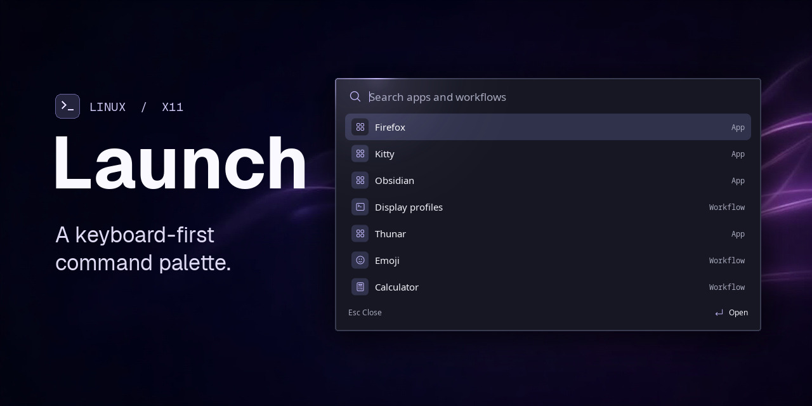

Launch is a Linux/X11 launcher written in C11 with [CUI](https://github.com/mattmezza/cui). Fuzzy-find apps, shell commands, workflows, and files from one field. It also includes an emoji picker, calculator, calendar, live system charts, and a `dmenu`-compatible entry point.

## Install

Run this command on Linux x86-64 or AArch64 to install or upgrade to the latest GitHub release.

```sh
curl -fsSL https://raw.githubusercontent.com/mattmezza/launch/main/install.sh | sh
```

The installer verifies the SHA-256 checksum and puts `launch` and `launch-dmenu` in `~/.local/bin`. Set `LAUNCH_INSTALL_DIR` to choose another directory, or append `-s -- v0.2.0` to `sh` to choose a specific release. Upgrades preserve your configuration and usage data.

The executable bundles its libraries, emoji data, and bang catalog. Launch still needs an X11 display, fontconfig configuration, and fonts. File activation uses `xdg-open` from `xdg-utils`.

### Build from source

You'll need a C11 compiler, Make, and pkg-config. On Debian or Ubuntu, the build dependencies are:

```sh
sudo apt install build-essential pkg-config libx11-dev libxinerama-dev libxext-dev \
  libcairo2-dev libpango1.0-dev libfontconfig1-dev libglib2.0-dev
git clone https://github.com/mattmezza/launch.git
cd launch
make
./build/launch
```

CUI and the lookup data are bundled. Launch uses Geist, Geist Mono, and Noto Color Emoji when available through Fontconfig.

Run `sudo make clean install` to install under `/usr/local`, or `make install PREFIX="$HOME/.local"` for a user install. Bind `launch` to your usual launcher shortcut. In sxhkd, use the release binding so the same shortcut also dismisses the overlay:

```
mod4 + @space
    launch
```

## Use

| From the palette | What it does |
| --- | --- |
| Type an app, command, or workflow name | Fuzzy-find it. **↑/↓** selects, **Enter** opens, and **Esc** backs out. An empty query shows your most-used entries. |
| `emoji` | Search emoji by name or keyword, move around the grid with arrows, and copy with **Enter**. |
| `calc` | Evaluate expressions such as `pi * 12.5^2` and copy the result with **Enter**. Supports `+ - * / % ^`, parentheses, and scientific notation. |
| `files alpine` | Search filenames and parent paths. Files also appear automatically when the palette finds no other results. **Enter** opens and **Ctrl+Enter** copies the path. |
| `Alpine wildflowers !w@work` | Open a Wikipedia search as a tab in the running work browser. Omit `@work` to use the default profile. HTTP(S) URLs also work, with an optional suffix such as ` @work`. |
| `calendar` | **←/→** switches Year, Month, Week, 3-Days, and Day. **↑/↓** moves between periods and **T** jumps to today. |
| `system` | View live CPU, GPU, RAM, disk, and network charts. **←/→** or **1–5** changes tabs, and **↑/↓** samples faster or slower. GPU readings depend on the Linux driver. |
| `mwm` | Switch focus, move windows and tags, or change layouts and desktop controls through `mwmc`. |

**Ctrl+←/→** moves by word, **Home/End** jumps to either end, and **Ctrl+A** selects all. Run `launch emoji`, `launch calc`, `launch calendar`, `launch system`, `launch files`, or `launch mwm` to open a workflow directly. Use `--print` with `emoji` or `calc` to send the selected value to stdout.

### Window management with mwm

With mwm running and `mwmc` on your PATH, search for **mwm** in Launch and press **Enter**. Try `focus next window`, `move window to tag`, `focus monitor`, or `columns layout`. Launch reads the current tags and monitors each time you open the workflow. Monitor actions appear when you have multiple monitors. Window actions apply to the focused window.

You can also enter an explicit command from within the workflow, such as `mwmc win move -40 0` or `mwmc focus tag "Project Work"`. Use this form for unassigned tags or other commands from `mwmc help`. Quoted arguments are passed directly to `mwmc`.

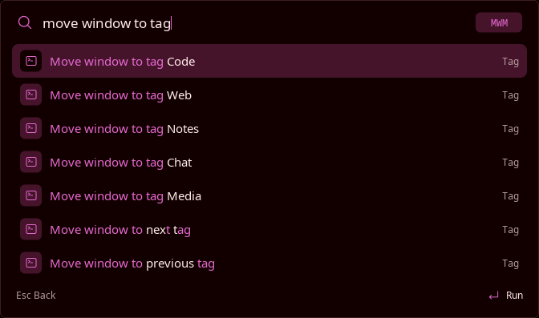

### Script pickers and dmenu

```sh
printf '%s\n' Internal External Both | launch pick --require-match -p 'Display'
printf '%s\n' Internal External Both | launch-dmenu -i -l 3 -p 'Display'
```

`launch pick` fuzzy-matches lines from stdin. `launch-dmenu` preserves dmenu's literal matching, input order, flags, and line-oriented stdout. You can also use `launch --dmenu` or `./build/dmenu`. The optional `make install-dmenu` installs a `dmenu` link when that name is free in the install prefix. See `launch --help` and `launch-dmenu --help` for flags.

## Configure

Copy [config.ini](config.ini) to `${XDG_CONFIG_HOME:-$HOME/.config}/launch/config.ini` and uncomment any values to override. The reference file lists all defaults. The source install also copies it to `share/launch`.

- **Window and startup.** Pick `startup=frequent`, `clock` (local time and month), or `minimal`. `placement=center` opens a floating panel and `top` or `bottom` opens a bar. Set the width, monitor, offsets, `corner-radius`, or `border-width` in pixels. `border-glow`, `glow-search-only`, and `glow-speed` control the animated accent.
- **Theme and keys.** Launch follows the `mwm` Xresources palette when it finds its background, foreground, and selection colors. It uses a thin outline and the `mwm.segradius` corner radius (6 px by default). Override the palette, fonts, or frame with `launch.*` Xresources such as `launch.accent`, `launch.chartCpu`, `launch.cornerRadius`, and `launch.borderWidth`. INI values override Xresources, and CLI flags take priority. `[keys]` adds shortcuts. `[dmenu]` configures the compatibility picker separately.
- **Files and charts.** Set search roots, exclusions, cache age, or `fallback=false` in `[files]`. Defaults are your XDG Documents, Downloads, and Desktop directories. `[system] interval-ms=1000` sets the initial chart refresh. Usage counts and cached file paths stay in the XDG state and cache directories respectively.
- **Browser profiles and bangs.** Set `[browser] default-profile=personal` and add `[browser personal]` and `[browser work]` with a `command` and `window-class`. The reference config shows two Helium instances with different `--user-data-dir` values and an optional `focus-command` for mwm. Keep the intended browser window open for the tab handoff. The full [Helium bang catalog](https://helium.computer/bangs) ships in `[bangs]`. Uncomment a trigger to change it, add one with `{searchTerms}` in the URL, or leave its value empty to disable it.

Add a group to make a command searchable. Commands take quoted arguments. Put pipelines or multi-step workflows in a script.

```ini
[workflow Reset displays]
keywords=monitor displays screen
command=xrandr --auto
```

Run it directly with `launch workflow "Reset displays"`. Any extra arguments are forwarded.

## Screenshots

### Palette and workflows

| Frequently used apps and workflows | Fuzzy app search |
| --- | --- |
| 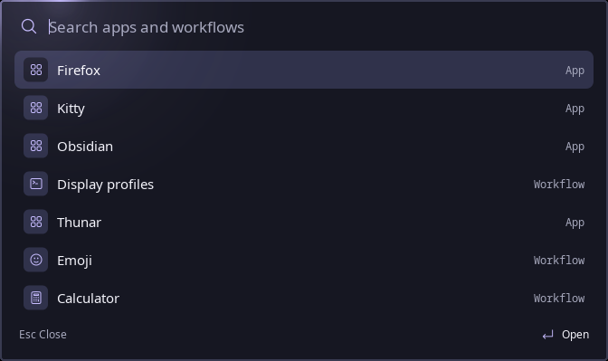 | 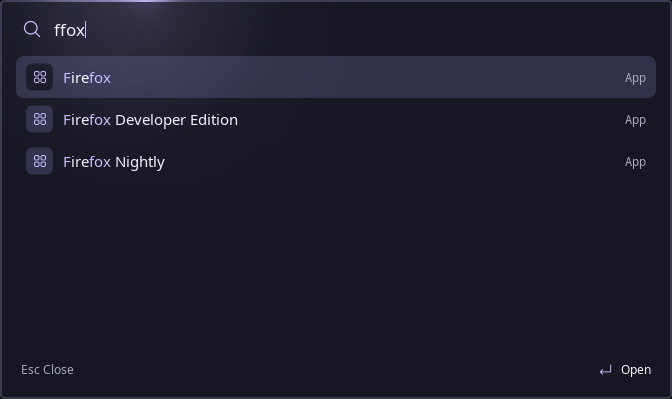 |
| **Custom workflows** | **Xresources theme** |
| 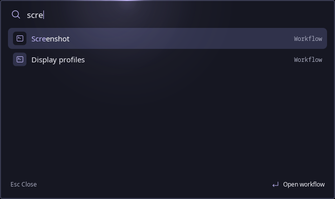 | 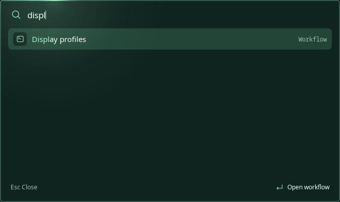 |
| **File fallback** | **Web search and browser profile** |
| 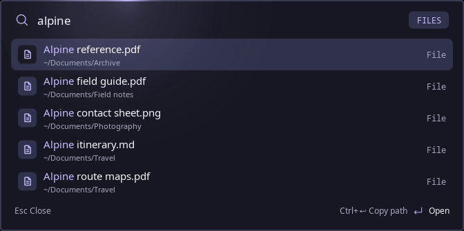 | 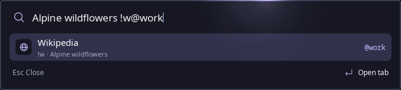 |
| **Emoji grid** | **Calculator** |
| 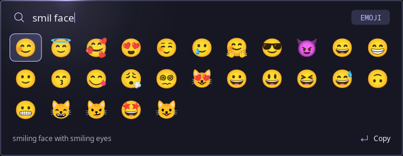 | 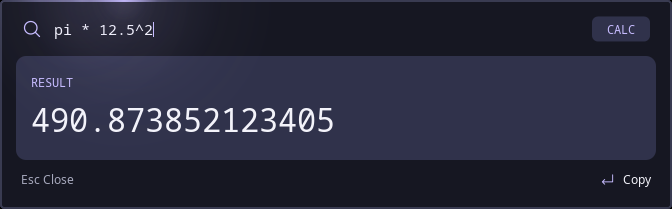 |
| **Clock startup** | **Minimal startup** |
| 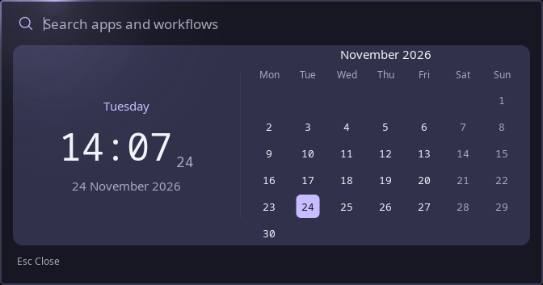 |  |
| **Scriptable dmenu picker** | **No results** |
| 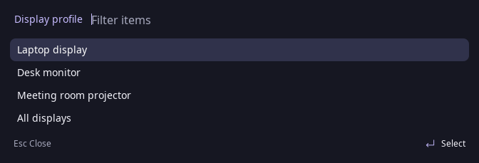 | 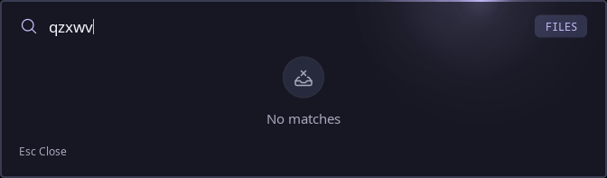 |

### Calendar

| Month | Year |
| --- | --- |
| 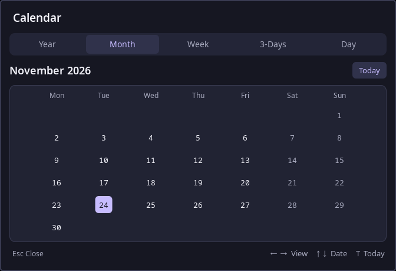 | 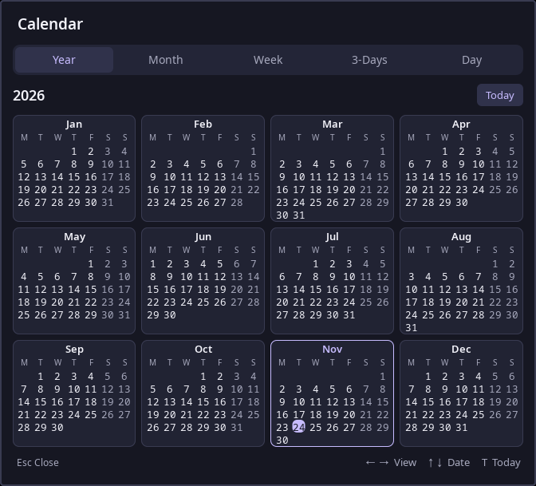 |
| **Week** | **3-Days** |
| 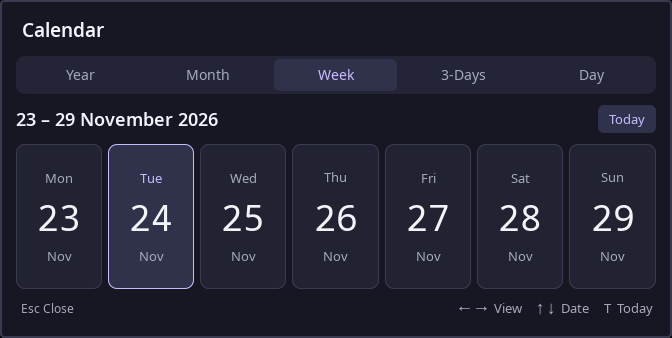 | 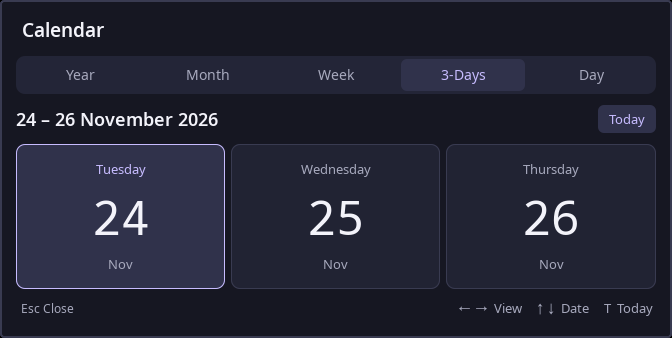 |
| **Day** | |
| 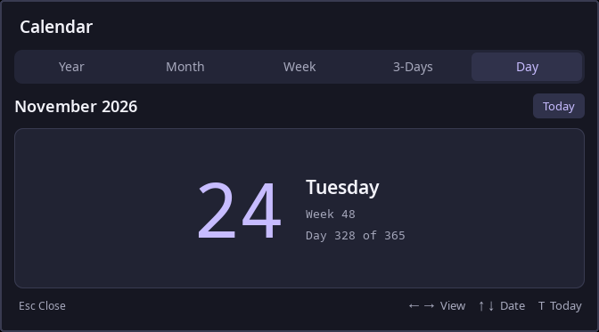 | |

### System

| CPU | RAM |
| --- | --- |
| 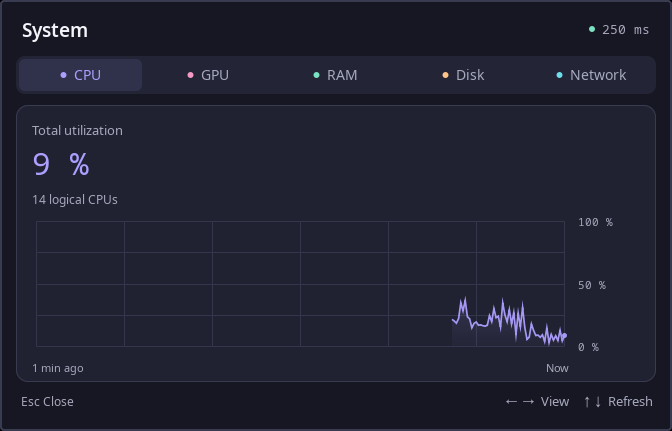 | 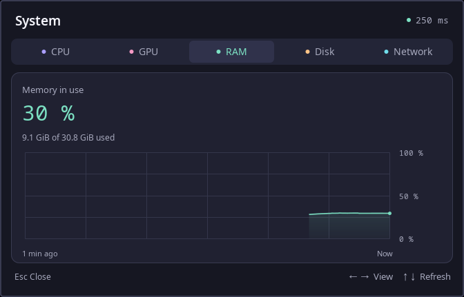 |
| **Disk** | **Network** |
| 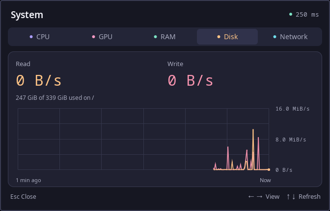 | 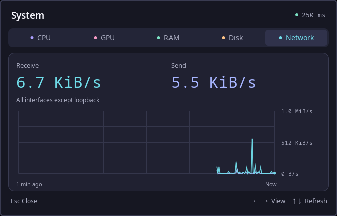 |

## License and maintenance

Launch is released under the [MIT License](LICENSE). This is a personal project and pull requests are closed. Run `make check` with Python 3, Xvfb, xauth, xdotool, xclip, and xev. Use `TEST_WM=mwm make check` to run under [mwm](https://github.com/mattmezza/mwm).

Third-party notices cover [CUI and Clay](vendor/cui/), [Heroicons](assets/HEROICONS-LICENSE), [Unicode Emoji and CLDR](assets/UNICODE-LICENSE), and [the Helium bang catalog](config.ini). The banner pairs Runware artwork with a real X11 capture.

### Cut a release

Use an authenticated GitHub CLI from the commit you want to release. Push that commit to GitHub and make sure the workflow is on `main`.

```sh
make release name=v0.2.0
```

This creates a draft release and starts the **Release Launch** workflow. GitHub Actions builds the tagged version for both architectures and runs the X11 checks. Once both builds pass, it attaches the executables, checksums, and relink archives, then publishes. A failed build leaves the release in draft. Retry from Actions or run the same command again from the same commit.
